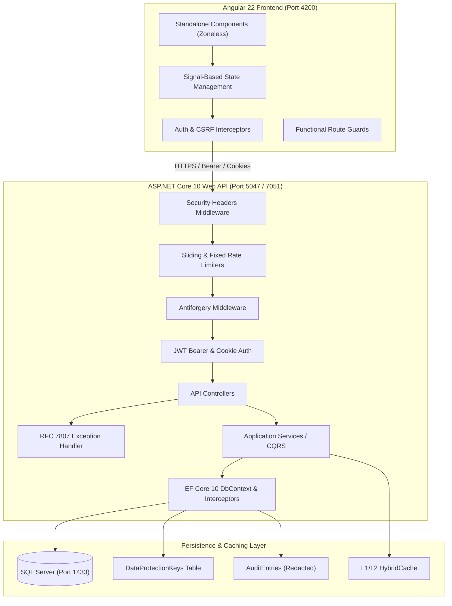

# SecurePortal: End-to-End Enterprise Reference Architecture

A production-grade, highly performant, end-to-end sample application built with **Angular 22** (Zoneless, Signals, Modern Control Flow, Deferrable Views), **.NET 10 Web API** (C# 14, Clean Architecture, EF Core 10), and **SQL Server**.

This project provides an exhaustive implementation covering **15 Critical Security Pillars** alongside cutting-edge performance patterns such as **Keyset Cursor Pagination**, **ASP.NET Core HybridCache**, and **Double-Submit CSRF Protection**.

---

## 🏛️ System Architecture



---

## 🛡️ 15 Core Security Pillars Matrix

| # | Security Pillar | Implementation Details & References |
|---|---|---|
| **1** | **Authentication** | Dual-mode authentication: Secure Bearer JWT + HttpOnly `__Host-` cookies with Refresh Token Rotation (RTR). Handled in [`AuthController.cs`](file:///C:/Projects/secure-portal/backend/src/Api/Controllers/AuthController.cs). |
| **2** | **Authorization** | Strict Role-Based Access Control (`Admin`, `Manager`, `Member`) using ASP.NET Core authorization policies (`[Authorize(Roles = "Admin")]`). Client-side verified via functional [`adminGuard`](file:///C:/Projects/secure-portal/frontend/src/app/core/guards/admin.guard.ts). |
| **3** | **HTTPS & HSTS** | Strict HTTPS redirection, HSTS with `max-age=31536000; includeSubDomains; preload`, and developer certificate bootstrapping via [`scripts/dev-certs.ps1`](file:///C:/Projects/secure-portal/scripts/dev-certs.ps1). |
| **4** | **Input Validation** | FluentValidation pipelines enforcing schema contracts, email normalization, strong password policies, and rejecting malformed inputs with HTTP 400. |
| **5** | **SQL Injection Resilience** | 100% Parameterized EF Core 10 LINQ queries; validated against raw SQL injection vectors (`' OR '1'='1' --`) with automated assertion in test suite. |
| **6** | **CORS** | Strict policy restricted to approved origins (`https://localhost:4200`, `http://localhost:4200`), allowing credentials (`withCredentials: true`), explicit methods, and custom headers (`X-XSRF-TOKEN`). |
| **7** | **CSRF / Antiforgery** | ASP.NET Core double-submit antiforgery token issued via `GET /api/antiforgery/token`, stored in secure cookie `XSRF-TOKEN` and validated automatically via request header. |
| **8** | **Rate Limiting** | Dual-layer ASP.NET Core Rate Limiting: 100 req/min sliding window globally + 10 req/min fixed window on authentication endpoints returning RFC 7807 `ProblemDetails` (HTTP 429). |
| **9** | **Secure Cookies** | `HttpOnly`, `SameSite=Strict`, `Secure=Always`, `__Host-` prefix enabled dynamically on HTTPS. Prevents script access and cookie tampering. |
| **10** | **Secrets Management** | Zero production secrets in code. Configuration via `.env`, ASP.NET User Secrets (`dotnet user-secrets`), and Docker Compose environment injection. |
| **11** | **Security Headers** | Custom [`SecurityHeadersMiddleware.cs`](file:///C:/Projects/secure-portal/backend/src/Api/Middleware/SecurityHeadersMiddleware.cs) injecting strict CSP, `X-Content-Type-Options: nosniff`, `X-Frame-Options: DENY`, `Referrer-Policy`, `Permissions-Policy`, and stripping Kestrel/ASP.NET server banners. |
| **12** | **Error Handling** | RFC 7807 compliant [`GlobalExceptionHandler.cs`](file:///C:/Projects/secure-portal/backend/src/Api/Middleware/GlobalExceptionHandler.cs) mapping domain exceptions to structured problem responses with unique correlation Trace IDs without leaking stack traces. |
| **13** | **Secure Logging** | Serilog structured logging enriched with [`SerilogPiiMaskingEnricher`](file:///C:/Projects/secure-portal/backend/src/Infrastructure/Logging/SerilogPiiMaskingEnricher.cs) and [`AuditableEntityInterceptor`](file:///C:/Projects/secure-portal/backend/src/Infrastructure/Persistence/Interceptors/AuditableEntityInterceptor.cs) masking `PasswordHash`, `RefreshToken`, and `SecurityStamp` to `[REDACTED]`. |
| **14** | **Data Protection** | ASP.NET Core Data Protection API keys persisted to SQL Server table `DataProtectionKeys` (`PersistKeysToDbContext<AppDbContext>()`), enabling multi-instance clustering without key mismatch. |
| **15** | **Dependency Security** | Governed by Central Package Management (`Directory.Packages.props`) with continuous audits (`dotnet list package --vulnerable`, `npm audit`). Verified: **0 backend vulnerabilities**, **0 frontend vulnerabilities**. |

---

## ⚡ Performance Innovations

1. **Keyset Cursor Pagination**:
   Replaces expensive SQL `OFFSET/FETCH` with cursor-based pagination (`WHERE (CreatedAtUtc, Id) < (@CursorDate, @CursorId)`). Encoded as Base64 timestamps for O(1) page access regardless of table depth.
2. **.NET 10 HybridCache**:
   Multi-tier caching combining in-process L1 cache with distributed serialization and tag-based cache eviction (`tasks` cache tag).
3. **Angular 22 Zoneless Change Detection**:
   Eliminates `zone.js` runtime overhead via `provideZonelessChangeDetection()`, utilizing pure reactive signals (`signal()`, `computed()`) for atomic DOM rendering.
4. **Deferrable Views (`@defer`)**:
   Defers non-critical component bundles (such as Quick Action widgets) until scrolled into the user's viewport (`@defer (on viewport)`).
5. **Ultra-Lean Bundle**:
   Frontend production build totals only **84.42 kB** initial transfer size with route-level lazy loading.

---

## 🚀 Quickstart Guide

### Prerequisites
- **.NET 10 SDK** (v10.0.100+)
- **Node.js** (v22.12.0+ & npm 10+)
- **SQL Server** (Local instance or Docker Desktop)

### 1. Database Setup
Ensure SQL Server is running on `localhost:1433`. Run the automated setup script:
```powershell
powershell -ExecutionPolicy Bypass -File scripts/setup.ps1
```

### 2. Launch Development Environment
To launch both the backend API and frontend SPA concurrently in separate terminal windows:
```powershell
powershell -ExecutionPolicy Bypass -File scripts/start-dev.ps1
```
- **Frontend URL:** `http://localhost:4200`
- **Backend API:** `http://localhost:5047`
- **Swagger Documentation:** `http://localhost:5047/swagger`

### 3. Run Automated Security & End-to-End Suite
To execute the automated 22-point security assertion suite:
```powershell
powershell -ExecutionPolicy Bypass -File scripts/test-security-e2e.ps1
```

---

## 🔑 Default Credentials

| Username | Password | Roles | Access Level |
|---|---|---|---|
| `admin` | `Admin@Secure2026!P@ss` | `Admin` | Full system access + Security Audit Log viewer |
| *(Register a new user)* | Custom | `Member` | Standard task management & document uploading |

---

## 📁 Repository Structure

```
secure-portal/
├── backend/
│   ├── Directory.Build.props          # Global compiler & security rules
│   ├── Directory.Packages.props       # Central Package Management
│   ├── nuget.config                   # Isolated package source
│   ├── SecurePortal.slnx              # .NET 10 Modern Solution
│   └── src/
│       ├── Domain/                    # BaseEntity, User, Role, TaskItem, Document, AuditEntry
│       ├── Application/               # DTOs, Validators, Services, Keyset Pagination
│       ├── Infrastructure/            # EF Core 10 DbContext, Interceptors, Data Protection
│       └── Api/                       # Controllers, Security Headers, Exception Handlers, Program.cs
├── frontend/
│   ├── src/
│   │   ├── app/
│   │   │   ├── core/                  # Auth, Toast, Interceptors (Auth, CSRF, Error), Guards
│   │   │   ├── features/              # Auth (Login/Register), Dashboard, Tasks, Documents, Audit
│   │   │   ├── shared/                # Layout (Navbar), Models, Keyset Contracts
│   │   │   ├── app.config.ts          # Zoneless configuration & functional interceptors
│   │   │   └── app.routes.ts          # Lazy-loaded route table
│   │   ├── index.html                 # Strict Content Security Policy meta
│   │   └── styles.css                 # Modern CSS design system & responsive layout
│   └── package.json                   # Angular 22 standalone configuration
├── scripts/
│   ├── dev-certs.ps1                  # Development HTTPS certificate tool
│   ├── setup.ps1                      # Solution restore, migration, and database seed
│   ├── start-dev.ps1                  # Concurrent full-stack startup script
│   ├── test-api.ps1                   # Core API pipeline test
│   └── test-security-e2e.ps1          # 22-check automated security verification suite
├── docker-compose.yml                 # SQL Server container definition
└── README.md                          # Full architectural and security reference
```
